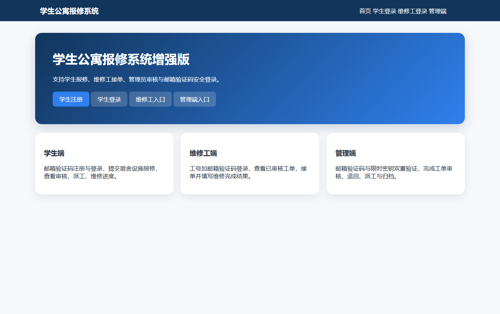
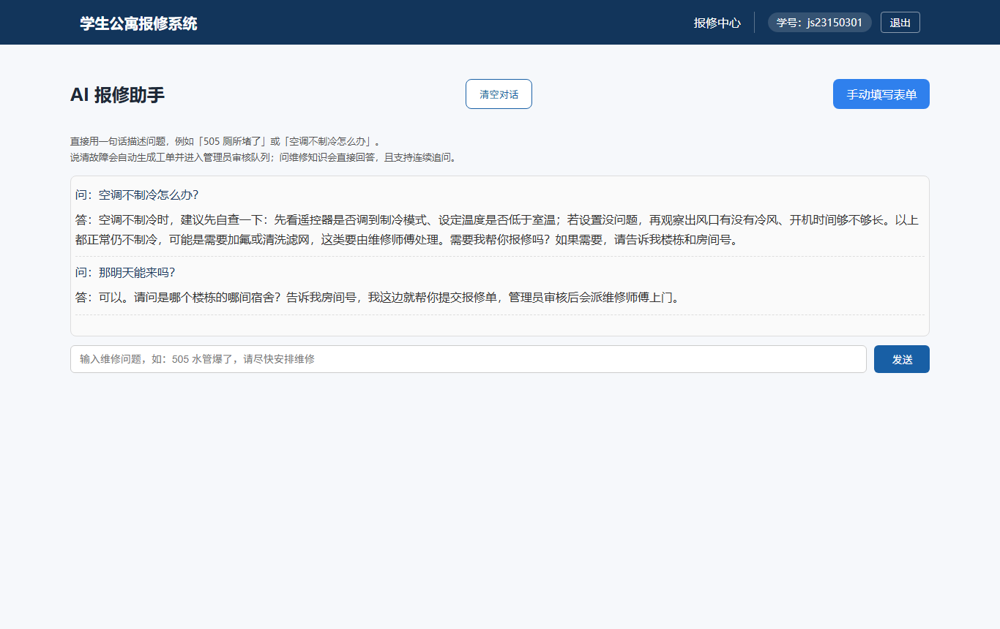
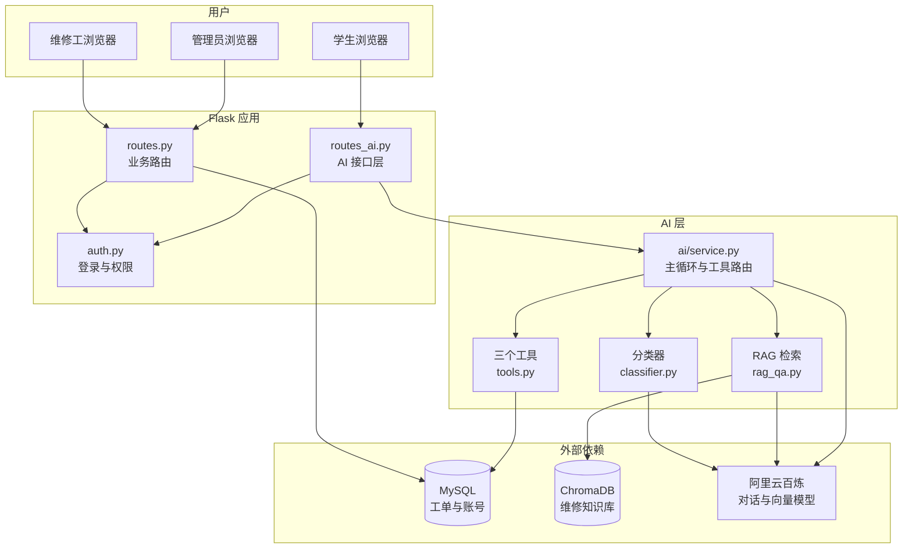
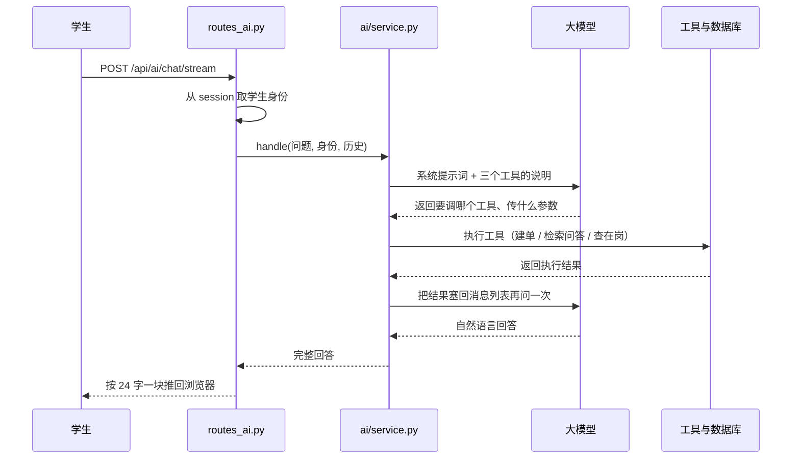

# 学生公寓报修系统（AI 增强版）

一套能真正跑起来的宿舍报修系统：学生用一句话描述故障，系统自动判断维修类型、生成工单，管理员审核后派给维修工，维修工上门处理，学生随时看进度。

技术上是一个 Flask 单体应用，接入了大模型和向量检索，让「填一张五个字段的表单」这件事变成「说一句话」。



---

## 这份文档怎么看

不用从头读到尾，按你的身份挑一节：

- 只想搞清这是什么、值不值得看 → 第一节，配图，不需要任何技术背景
- 想知道它用起来什么感觉 → 第二节，有真实对话记录
- 想在自己电脑上把它跑起来 → 第三节，有完整命令和常见报错
- 想了解技术实现和设计取舍 → 第四节，面试和答辩看这里

补充说明放在最后两节：目录结构、已知限制。

---

## 一、这个系统解决什么问题

宿舍东西坏了，过去通常是这样：在群里喊一声「我们宿舍水管爆了」，宿管看到后打电话找维修师傅，师傅什么时候来、修没修好，全靠再问一次。中间任何一环断了，事情就卡在那里。

这个系统把这条路变成了有记录的流程。学生报修时留下文字和照片，工单进入系统，管理员能看到所有待处理的单子并指派给具体的人，维修工接单后处理并在系统里填写结果，学生打开页面就能看到当前状态。每一条工单都有编号、有状态、有责任人、有时间戳。

在此基础上加了一层 AI。原本学生要填楼栋、房间号、故障类型、紧急程度、描述，其中故障类型还得自己判断该选「水电维修」还是「门窗维修」。现在只要在对话框里说一句「508 的灯不亮了」，系统会自己把楼栋、房间号、故障类型从这句话里抽出来，生成工单。

三个角色各看到不一样的东西：

学生端负责报修和查进度，登录后直接进 AI 助手页。维修工端是待接的单子和自己接过的单子，完成后填写维修结果并上传照片。管理端能看到全量工单，做审核、退回、派单，还能管理维修工和管理员账号。

管理员登录取的是「密码 + 邮箱验证码」，其中超级管理员 MX001 还要额外输入一个限时密钥，这是为了演示权限分级，不是给真实场景用的设计。

---

## 二、用起来是什么样

### 学生的完整流程

打开首页，点「学生登录」，输入学号、邮箱、密码，再点「获取验证码」，去邮箱拿六位数字填进去，登录成功。

登录后落在 AI 报修助手，不是传统的工单列表。页面上就一个输入框，下面一行小字提示可以怎么说。输入「508 的灯不亮了，麻烦安排人来看一下」，回车。

系统做三件事：判断这是报修而不是咨询，从话里提取楼栋和房间号，调用建单工具把工单写进数据库。返回给你的是类似这样的话：已为你提交工单，编号 26，类型是电器维修，房间 5 号楼-508 宿舍，正在等管理员审核。

如果你只是问「空调不制冷怎么办」，系统不会建单，而是先从维修知识库里检索相关条目，再组织成一段可操作的说明，最后问你需不需要报修。这个区分不是靠关键词匹配，是让模型在三个工具之间自己选。



上面的图是演示对话，展示两件事：一是问维修知识会得到带步骤的回答并主动追问房间号，二是连续追问能接上上文（第二句只说了「那明天能来吗」，系统仍知道指的是刚才那个报修）。

页面右上角还有一个「手动填写表单」按钮，跳转到原来的表单页。不想用 AI 或者 AI 听不懂的时候，这条路一直在。

### 维修工和管理员

维修工用工号加邮箱验证码登录，看到的是管理员审核通过、还没人接的单子，接单后单子进入自己的列表，完工时填维修结果、上传照片，工单状态变成已完成。

管理员登录后是工单总览，可以按状态筛选。审核通过的单子才会出现在维修工那边，也可以退回并说明原因。人员管理页可以新增维修工和管理员账号。

### 一个真实的运行记录

下面这段是实际调用返回的内容，没有改写：

```
问：空调不制冷怎么办？

答：空调不制冷时，建议先自查一下：

1. 检查遥控器是否调到了「制冷」模式，温度是否设置得比室温低；
2. 如果设置没问题，可以观察出风口是否有冷风、开机时间是否够长。

如果以上都正常但仍然不制冷，可能是需要加氟或清洗滤网，这些需要维修师傅处理。
需要我帮你报修吗？如果需要，请告诉我你的宿舍房间号和具体楼栋。
```

这一次调用从上到下走完了整条链路：HTTP 请求进来、从 session 取身份、模型决定调问答工具、检索知识库、模型组织回答、分块推回浏览器，耗时约十三秒（首次调用含模型冷启动）。

---

## 三、在自己电脑上跑起来

### 你需要准备什么

Python 3.10（不建议 3.13，向量库 chromadb 在新版本上经常没有现成的安装包，会在装依赖那步失败），MySQL 8，一个阿里云百炼的 API Key（免费额度够演示用）。

没有百炼 Key 也能启动系统，只是 AI 那三块功能会在调用时报错，普通报修流程仍然可用。

### 第一步，建数据库

打开 Navicat 或命令行，先建一个库，名字叫 cjl_505，字符集用 utf8mb4。然后把项目根目录的 schema_mysql.sql 整个执行一遍，它会建出学生、维修工、管理员、工单、验证码这几张表。

AI 问答依赖的向量库不随仓库提供（二进制数据不入库），第一次要灌一次：python ai/rag/faq_kb.py。跑完会生成 ai/chroma_db 目录，之后不用再跑。只演示普通报修流程可以跳过这一步。

### 第二步，装依赖

```bash
cd 07_完整系统
python -m venv venv
venv\Scripts\activate
pip install -r requirements.txt
```

requirements.txt 里已经包含 MySQL 驱动 pymysql，不需要额外装。这一步会拉 chromadb，体积较大，慢是正常的。

### 第三步，配环境变量

项目根目录有一个 .env.example，复制成 .env 再填值。三组配置里有两组是必填的。

第一组是数据库连接。默认值写在 config.py 里，本机 MySQL 如果用默认的 localhost:3306、账号 root、密码 123456、库名 cjl_505，可以不填；不一致就填 MYSQL_HOST、MYSQL_PORT、MYSQL_USER、MYSQL_PASSWORD、MYSQL_DB。

第二组是邮箱 SMTP，这是登录能不能用的关键。系统所有登录都走邮箱验证码，验证码真的会发邮件出去，所以必须填一个能发信的 QQ 邮箱和它的授权码（注意是授权码，不是登录密码，在 QQ 邮箱设置里开启 SMTP 服务后生成）。不填这一组，页面能打开，但你永远登不进去。

仓库里这一项刻意没有留默认值。授权码属于凭据，不能进代码；所以必须自己填 SMTP_PASSWORD，代码不会回退到任何内置值。

第三组是 AI 的 API Key，填 DASHSCOPE_API_KEY。只做业务演示可以不填，要演示 AI 就必须填。

代码里只读环境变量、不写默认值，所以缺少 Key 时不会在启动时报警，而是在第一次调用 AI 时才失败。看到「系统能打开但 AI 没反应」，先查这一项，这不是 bug。

### 第四步，启动

```bash
python app.py
```

看到 Running on http://127.0.0.1:5000 就好了。浏览器打开这个地址，首次启动会自动创建测试账号。

### 第五步，登录

学生账号是 js23150301，密码 123123。邮箱填的是你配置的 SMTP_USER，因为默认账号建库时用的就是这个地址，登录会校验学号与邮箱是否匹配。维修工是 WX001，管理员是 MX001，密码都是 123123，MX001 的验证密钥在第七节。

邮箱必须是数据库里存的那个，因为登录时会校验学号和邮箱是否匹配，随便填一个邮箱会提示「学号、邮箱或密码错误」。

### 常见报错

连不上数据库，先确认 MySQL 服务在跑、库名拼写对、密码对。报错信息里出现 Can't connect to MySQL server 基本就是这三件事之一。

启动就报 ModuleNotFoundError，说明依赖没装全或者装到了别的 Python 环境里。用 venv 的话确认激活成功，命令行提示符前面应该有 (venv)。

页面 500 错误，翻控制台日志。项目开了 debug 模式，浏览器里也会直接显示堆栈，能看到具体是哪一行。

AI 返回 403 或者提示额度不足，先确认调用的模型名是 deepseek-v4-pro-0813 而不是 deepseek-v4-pro。阿里云的免费额度按模型快照独立发放，写别名会命中另一条没有额度的池子，控制台显示有额度也会报 403。这个坑踩过一次，写在第四节了。

---

## 四、技术上是怎么做的

### 整体结构



### 一次提问发生了什么



这张图是理解整个 AI 部分的关键。注意第三行和第七行：模型不是被直接调用一次就结束，而是「问模型 → 模型要调工具 → 执行工具 → 把结果还给模型 → 再问一次」。这个来回最多五轮，超过就停。这就是所有 Agent 系统的主循环，手写一遍之后再去看 LangChain 之类的框架，会发现它们做的事就是把这个循环封装起来。

### 三个 AI 功能各自在做什么

报修分类是第一块。学生说「厕所下水道堵了还往外冒水」，系统需要判断这属于水管类还是其他类。做法是把 24 条标注好的样本作为示例放进提示词，让模型照着格式输出 JSON，再用代码校验输出的类别是否在允许的枚举里。这里有个必须做的动作：模型返回的 JSON 格式正确不代表值合法，它可能返回一个不存在的类别，所以枚举校验这一层不能省。实测 24 条样本的完全正确率是 91.7%，剩下两条是标注本身有歧义。

知识问答是第二块，也就是常说的 RAG（检索增强生成）。直接用模型回答维修问题会瞎编，因为它不知道你们宿舍的维修规定。做法是先把维修知识整理成条目存进向量库，提问时先检索出最相关的三条，再把这三条和问题一起交给模型，让它只根据检索到的内容回答。检索不到相关内容时，它会明确说没找到，而不是硬编一个答案。检索有两个旋钮，返回几条和相似度阈值，都能调。

自动建单是第三块，用 Function Calling 实现。三个工具分别是建单、问答、查维修工是否在岗，每个工具都有名字、说明和参数格式，一起交给模型。模型根据用户说的话自己决定调哪个。这里刻意没有写「如果句子里有『坏了』就走建单」这类判断，因为真实表达太杂，关键词漏一个就分流错了。

### 几个必须解释的设计取舍

身份不能从前端传。建单要知道是谁的工单，这个信息只从 Flask 的 session 里取，工具的参数定义里根本没有 student_id 这一项。原因很简单：只要前端能传，用户改个请求就能把工单建到别人名下。

校验要放在工具里面，不是调用方。房间号是不是合法、维修工是不是在岗，这些检查写在工具内部。因为工具未来可能被别的入口调用，校验跟着能力走，不跟着入口走。

宿舍地址只有一种写法。「X 号楼-XXX 宿舍」，由 ai/common/format_utils.py 里几个纯函数统一处理，学生表单和 AI 建单两条路共用同一套规则。这个文件单独存在是因为两边都要 import，放任何一侧都会让另一侧连带加载 Flask 或数据库驱动。

楼栋从用户原话里推。学生表里没有存宿舍号，所以 AI 建单时楼栋只能从话里提取，按可靠性排五级：先看工具参数里有没有，再看登录身份里有没有，再从房间号和故障描述文本里正则找，还找不到就按房间号首位推断（505 默认 5 号楼，只对三位纯数字生效，A208 这种不猜），全失败才落到默认 1 号楼。这个启发式不完美，但比全部写成 1 号楼强，存量数据里就有一张因为这个 bug 落错楼栋的工单。

多轮上下文放在服务端内存。Flask 默认把 session 存在 cookie 里，浏览器单条 cookie 上限约 4KB，中文经过 JSON 转义一个字要占六字节，聊四轮就能把 cookie 撑爆、直接丢掉登录状态。所以对话历史存进程内存，代价是重启就丢。生产环境应该换 Redis。

### 模型不是确定性组件，所以要设闸

这是整个 AI 部分最值得讲的经验。模型会以各种方式「坏」，每一条闸都对应一种坏法：

工具循环上限 5 轮，防的是模型每轮都要求调工具，导致无限循环、烧额度、请求永不返回。请求超时 20 秒，防的是一个卡死的请求占住 Flask 的工作线程（SDK 默认超时是 600 秒）。关掉 SDK 自带重试，重试交给自己的降级逻辑处理，否则会出现「SDK 重试三次 × 每次 20 秒」的双重等待。建单幂等五分钟，防的是用户手抖连点、前端失败重试、模型重复调工具，建出好几张一模一样的工单。分类返回「未知」时拒绝建单，防的是脏数据进库。对话历史保留四轮，防的是追问接不上上文。

这六条都在 config.py 里，改参数不用动代码。

### 模型与降级

主模型用阿里云百炼托管的 DeepSeek-V4-Pro，快照名 deepseek-v4-pro-0813。备用模型 qwen-turbo，主模型返回 429 限流或 403 配额耗尽时自动切换，额度恢复后按请求重新走主模型。向量模型用 text-embedding-v3，和对话模型共用同一把 Key。

为什么必须写快照全名：百炼的免费额度按模型快照独立发放，别名和快照是两条额度池。写别名 deepseek-v4-pro，即使控制台显示还有 100% 额度，调用仍然返回 403；改成带日期的快照名就正常。代价是平台下线该快照时要手动改配置。

DeepSeek-V4 默认开启思考模式，对分类这类任务纯属浪费，而且思考过程的 token 会挤占输出空间。代码里按模型名前缀判断，是对 deepseek 系就显式关掉。老款 qwen 模型传这个参数会直接 400，所以不能无脑加。

流式输出要说清楚：当前是分块推送，不是模型逐 token 流式。因为工具调用必须完整拿到结果才能继续，模型那一段仍是一次性返回，回答确定后再按 24 字一块推给前端。观感上是打字机效果，首块之前还是得等模型。真正的 token 级流式需要改 SDK 调用方式并处理工具调用的增量返回，暂时没做。

### 和第一版的差别

第一版是五个平级目录加 sys.path hack，合并时改成了一个 ai/ 包、全部走包导入。向量库路径从依赖目录结构的相对路径改成随包发布的绝对路径。向量库客户端从 import 时创建改成惰性单例，避免调试模式下重载时建两次。数据库密码和邮箱授权码从硬编码改成读配置与环境变量。建单身份从写死改成由接口层注入。模型名原来散在四个文件里，现在收口到 config.py。

---

## 五、目录结构

```
正式版/
├── app.py              应用入口：创建 Flask 实例、注册路由、启动
├── config.py           全部配置与阈值（数据库、邮箱、模型、六道闸参数）
├── db.py               数据库连接与建表
├── auth.py             登录校验装饰器、超级管理员判断
├── verification.py     验证码生成、发送、校验
├── routes.py           业务路由：注册、登录、工单、派单、人员管理
├── routes_ai.py        AI 接口层：助手页面、对话接口、流式接口、清空上下文
├── schema_mysql.sql    建表脚本
├── requirements.txt    依赖清单
├── .env.example        环境变量模板，复制成 .env 后填值
├── static/             样式与上传的维修照片
├── templates/          页面模板
├── docs/screenshots/   本文档用到的截图
└── ai/                 AI 能力包
    ├── service.py      三合一入口：模型路由、工具循环、守卫
    ├── common/         模型调用封装、提示词模板、宿舍格式工具函数
    ├── classify/       报修分类
    ├── rag/            知识库灌库与检索问答
    ├── autoorder/      三个工具的定义与实现
    └── chroma_db/      向量数据（不入库，首次运行 ai/rag/faq_kb.py 生成）
```

---

## 六、已知限制

这些都不是「跑不起来」，而是「跑得起来但还不完善」。答辩和演示够用，当生产系统用需要逐项补。

工单表没有优先级列。分类器其实会输出紧急程度，但库里没地方放，只能塞进描述字段的前缀里，后台没法按优先级排序和筛选。要改就是加一列。

学生表没有宿舍号列。所以 AI 建单时楼栋只能从用户原话里推，学生完全不提楼栋时会落到默认的 1 号楼。正解是给 students 表加 dorm_building 列，登录时写进 session，代码里这条链路已经预留好了。

分类词表有两套。AI 分类器输出的是「电器、水管、门窗、家具、其他」，而表单下拉里是「水电维修、门窗维修」这类，同一张表里混着两种口径，做统计会分裂。需要统一成一套。

对话历史存在进程内存里，重启即丢，多进程部署时每个进程各存各的。单机演示没问题，要上生产得换 Redis 或者建会话表。

没有限流、没有回答缓存、没有调用日志和 token 计量。连续提问会重复消耗额度，成本也没法按次核算。

流式是分块推送而不是模型逐 token 流式，前面解释过原因。

---

## 七、默认账号与环境变量

程序首次启动自动创建的测试账号，密码统一 123123：

```
学生     学号 js23150301   邮箱 取 SMTP_USER
维修工   工号 WX001        邮箱 取 SMTP_USER
管理员   MX001 / MX002…    邮箱 取 SMTP_USER
```

超级管理员 MX001 登录时额外要求一个密钥：

```
7a3f9e2d8b1c4560a7f3e9d2b8c1a456
```

环境变量清单，全部可以写在 .env 里：

```
MYSQL_HOST  MYSQL_PORT  MYSQL_USER  MYSQL_PASSWORD  MYSQL_DB
SMTP_USER  SMTP_PASSWORD  SMTP_SENDER
DASHSCOPE_API_KEY
LLM_MODEL  LLM_FALLBACK_MODEL  LLM_ENABLE_THINKING  LLM_BASE_URL
FLASK_SECRET_KEY
```

前三行是必填或视情况必填：数据库不一致才填，登录必须配邮箱，AI 功能必须配 Key。第四行是模型微调用的可选覆盖项。第五行是会话签名密钥，本地演示用默认值没关系，公开部署必须换。
