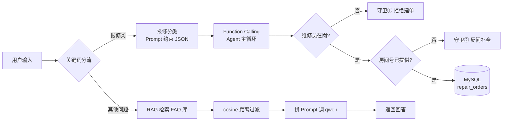

# AI 驱动宿舍维修系统

把「学生一句话报修」到「工单落进数据库」的整条链路交给大模型，同时用代码守住业务底线。

> 这是一个 AI 能力模块，不是一个完整的维修管理系统 —— 业务外壳（登录、工单列表页等）不在范围内，重点是三个 AI 功能各自的实现方式，以及它们怎么合成一条链路。

## 三个 AI 功能

| 功能 | 做什么 | 关键技术 |
|------|--------|---------|
| **报修分类** | 一句话自动判断问题类别 + 紧急程度 | Prompt 约束模型输出 JSON |
| **智能问答** | 基于维修 FAQ 知识库回答问题，**查不到就明说不知道** | RAG：向量检索 → 阈值过滤 → 拼 Prompt |
| **自动建单** | 一句话自动创建工单并写入数据库 | Function Calling + Agent 主循环 |

三个功能由 `第二周/ai_service.py` 的 `handle()` 统一入口按关键词分流：
- 含「修 / 坏 / 漏 / 堵 / 响 / 裂」→ 走报修流程（分类 → 建单）
- 其他 → 走 RAG 问答

## 整体流程



## 技术栈

| 组件 | 用途 |
|------|------|
| Python 3.10 | 运行环境 |
| 通义千问 qwen（DashScope） | 大模型：分类、生成回答、Function Calling |
| text-embedding-v3 | 文本向量化 |
| ChromaDB | 向量数据库，存 FAQ 并做相似度检索 |
| MySQL | 业务数据库，存工单 |
| Flask | 网页问答接口 |
| dashscope / openai SDK | 两套 SDK 并存：第一周用 dashscope 原生 SDK，第二周用 openai 兼容模式 |

> **关于两套 SDK**：`qwen_client.py`（第一周）用 `dashscope.Generation`，第二周改用 `openai.OpenAI` 的兼容模式端点。这是演进过程留下的，不是设计缺陷 —— 兼容模式在写 Function Calling 时更顺手。

## 目录结构

```
ai-repair/
├── chroma_db/                    # ChromaDB 持久化数据（FAQ 向量库）
├── 第一周/                        # 报修分类 + RAG 问答
│   ├── classifier.py             # ① 报修分类
│   ├── embedding_demo.py         # Embedding 语义相似度对照实验
│   ├── faq_kb.py                 # 知识库：20 条 FAQ 存入 ChromaDB
│   ├── rag_qa.py                 # ② RAG 问答核心
│   ├── chat_注释版.py             # Flask 接口 POST /api/chat
│   ├── chat.html                 # 最简聊天框
│   ├── qwen_client.py            # API 封装（重试 / 指数退避 / 备用模型）
│   ├── prompt_templates.py       # Prompt 模板库
│   └── 8.14调参记录.txt           # Top-K / 阈值调参结论
└── 第二周/                        # Function Calling + Agent
    ├── tools.py                  # ③ 工具定义（schema）+ 真实实现（写 MySQL）
    ├── auto_order.py             # FC 单轮版示例
    ├── agent_repair.py           # FC 主循环 + 守卫①（脚本版）
    ├── ai_service.py             # 三合一入口 handle()，含两个守卫
    └── agent_repair_注释版.py     # 主循环逐行注释版
```

## 快速开始

### 1. 环境要求

- Python 3.10+
- MySQL 5.7+ / 8.0（本地运行即可）

### 2. 安装依赖

```bash
pip install chromadb dashscope openai pymysql flask flask-cors
```

### 3. 配置 API Key

代码通过环境变量读取密钥，**不写死在代码里**（缺失时直接抛 `KeyError`，不静默回退）：

```bash
# Windows（永久生效，之后需要重开终端）
setx DASHSCOPE_API_KEY "sk-你的key"
```

Key 从[阿里云百炼控制台](https://bailian.console.aliyun.com/)获取。

### 4. 初始化数据库

建库 `cjl_505`，再建工单表（下面是按代码调用反推的最小字段集，已有表可跳过）：

```sql
CREATE DATABASE IF NOT EXISTS cjl_505 DEFAULT CHARSET utf8mb4;

CREATE TABLE repair_orders (
  id            INT AUTO_INCREMENT PRIMARY KEY,
  student_id    INT NOT NULL,
  student_no    VARCHAR(20),
  dorm_building VARCHAR(20),
  room_no       VARCHAR(10),
  category      VARCHAR(20),
  description   TEXT,
  status        VARCHAR(20) DEFAULT 'pending_review',
  worker_id     INT NULL,
  created_at    DATETIME
);
```

连接参数在 `第二周/tools.py` 的 `get_conn()` 里，按自己环境改（默认 `localhost:3306` / `root` / 库名 `cjl_505`）。

### 5. 初始化 FAQ 知识库

只需跑一次，把 20 条维修 FAQ 向量化后存进 ChromaDB：

```bash
cd 第一周
python faq_kb.py
```

### 6. 运行与验证

**三个功能分别单独验证：**

```bash
cd 第一周
python classifier.py      # ① 分类：5 条报修测试文本
python rag_qa.py          # ② 问答：空调不制冷 / 洗衣机坏了
```

```bash
cd 第二周
python auto_order.py      # ③ FC 单轮版：演示模型决定调工具 → 执行 → 汇总回答
python agent_repair.py    # ③ FC 主循环版 + 守卫①
```

**整合入口（推荐）：**

```bash
cd 第二周
python ai_service.py      # 三合一：报修建单 + RAG 问答一次跑通
```

**网页问答：**

```bash
cd 第一周
python chat_注释版.py      # 起 Flask 服务，浏览器打开 chat.html 即可提问
```

> ⚠️ **命令必须在对应目录下执行**。第一周代码用 `import qwen_client` 这类同目录导入；第二周通过 `sys.path` 挂载第一周目录。跨目录运行会报 `ModuleNotFoundError`。

## 效果示例

`python ai_service.py` 的典型输出：

```
用户:505水管爆了，尽快安排维修
系统分类: {'category': '水管', 'urgent': '是'}
系统：已为您创建工单（工单号 12），问题：505 房间水管爆裂，优先级 high，当前状态 pending_review，请等待审核。

用户:空调不制冷怎么办
系统：请先检查空调滤网是否积灰，若清理后仍不制冷，可能是缺氟或压缩机故障，建议报修处理。

用户:洗衣机坏了，怎么修
系统：抱歉，资料里没有关于洗衣机维修的相关信息，我无法回答。
```

最后一条是 RAG 的**反幻觉设计**：知识库里没有的内容，系统会承认不知道，而不是编一个答案。

## 几个关键设计决策

**1. 为什么用 cosine 距离而不是默认的 L2？**

ChromaDB 默认是欧氏距离，但文本相似度用余弦更合理 —— 向量长度受文本长短影响，余弦只看方向。建库和查询两侧都显式设了 `metadata={"hnsw:space": "cosine"}`，口径必须一致，否则检索结果会毫无意义。

> 注意：cosine 空间下 ChromaDB 返回的 `distances` 是**距离**（= 1 − 相似度），**越小越相似**。所以 `rag_qa.py` 里 `if s <= 0.5` 的含义是「距离不超过 0.5 才保留」，等价于「相似度 ≥ 0.5」。

**2. 为什么 Top-K = 3、阈值 = 0.5？**

这是 8/14 的对照实验结论（记录在 `8.14调参记录.txt`）：K=1 信息太窄，K=8 会混入无关资料；阈值 0.5 能挡住「洗衣机」这类知识库里没有的问题。阈值过滤是**防幻觉的第一道防线**，Prompt 里「资料里没有的就直接说不知道」是第二道。

**3. 为什么业务规则要写死在代码里，不能交给 Prompt？**

模型的输出是概率性的，Prompt 只能提高它遵守规则的概率，做不到 100%。所以「维修员不在岗不派单」「房间号缺失不建单」这类**绝不能出错**的规则，必须在工具执行前用代码拦截：

```python
if not worker_available:
    result = {"error": "维修员不在岗,按规则拒绝建单,请更换维修员"}
elif not str(func_args.get("room", "")).strip():
    result = {"error": "房间号缺失,请先询问用户房间号后再建单"}
else:
    result = create_work_order(**func_args)
```

之所以拦得住，是因为**模型没有执行能力** —— 它只能「请求」调用工具，真正的执行权在代码手里。这是 Function Calling 架构比纯 Prompt 可靠的根本原因。

**4. 为什么分类结果要以 system prompt 注入？**

先由 `classifier.py` 分类，再把结果写进 system prompt，并要求模型「category 和 priority 必须使用上述值，不要自己编」。这样模型只负责填工具参数，不负责决定类别 —— 把不确定性收敛到可控范围内。

## 进度

- [x] 报修分类（8/10）
- [x] Embedding 语义相似度实验（8/11）
- [x] FAQ 知识库 + ChromaDB（8/12）
- [x] RAG 问答（8/13）
- [x] Top-K / 阈值调参（8/14）
- [x] 网页问答接口（8/15）
- [x] Function Calling 工具定义 + MySQL 落库（8/19）
- [x] FC 主循环 + 业务守卫（8/22）
- [x] 三模块整合入口 `ai_service.py`（8/23）
- [x] README / 项目文档整理

## 已知局限

- **没有会话记忆**：每轮请求独立，模型不记得上一句话。多轮追问要靠用户重新说清上下文。
- **没有上下文截断**：一旦加上记忆，长对话会超出 context window，需要截断策略。
- **分类靠关键词分流**：`handle()` 用「修/坏/漏/堵/响/裂」判断是否走报修流程，遇到不含这些字的报修（如「空调不工作」）会误判成问答。更稳的做法是意图分类。
- **未部署**：目前只能在本地跑，没有 Docker 化。
