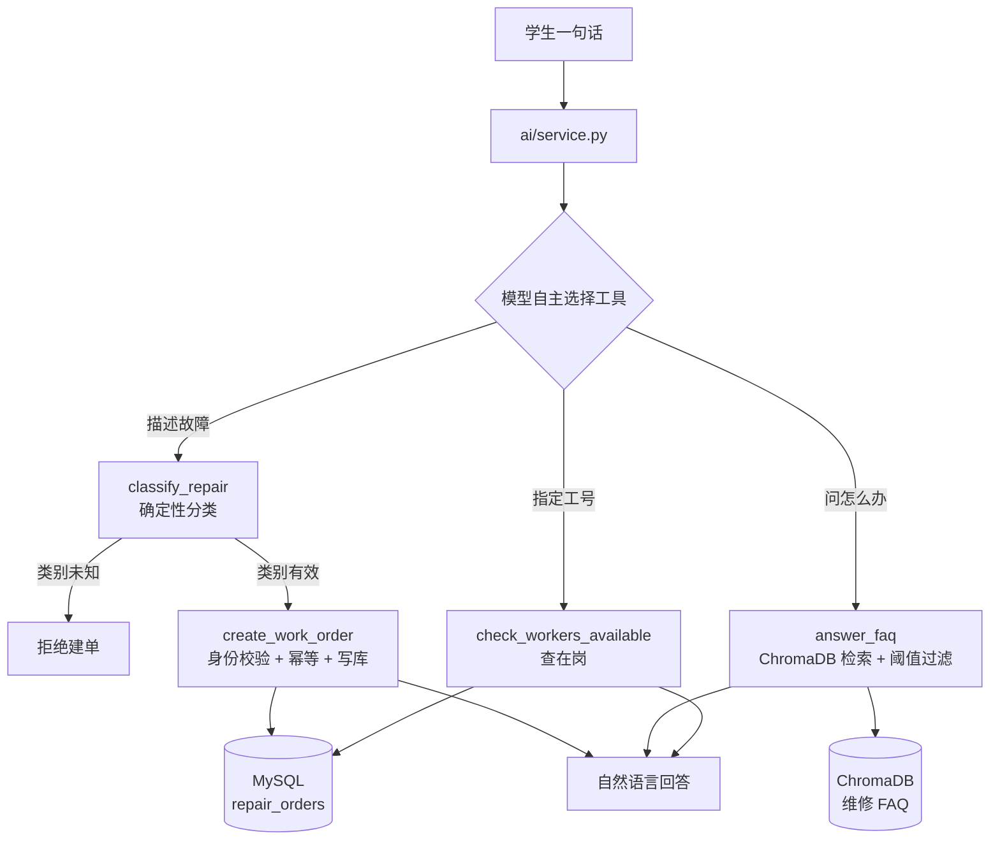

# 宿舍报修 AI 系统

把「学生说一句话」到「工单落进数据库」这条链路交给大模型，同时用代码守住业务底线。

仓库分两层：`01_` 到 `06_` 是逐个功能拆开的学习模块，按阅读顺序编号；`07_完整系统` 是这些模块合进一套可运行的 Flask 应用之后的样子，有登录、有三种角色、有对话页面。

> 学习模块保留原始形态，包括当时的写法、当时的缺陷。完整系统是重构后的版本，两者不要互相覆盖。

## 三个 AI 能力

报修分类。一句话判断问题类别和紧急程度。做法是把标注样本放进提示词，让模型按固定格式输出 JSON，再用代码校验输出值是否落在允许的枚举里。这一步不能省：JSON 格式合法不代表值合法，模型会返回一个不存在的类别。

知识问答。基于维修知识库回答，查不到就明说不知道。做法是向量检索出最相关的三条，拼进提示词让模型只依据这三条作答；检索距离超过阈值时直接判为「资料里没有」。阈值过滤是第一道防幻觉，提示词里的「不知道就说不知道」是第二道。

自动建单。一句话创建工单并写入 MySQL。做法是 Function Calling：把建单、问答、查维修工在岗三个工具交给模型，由模型自己决定调哪个。这里刻意没有写「句子里出现修、坏、漏就走建单」这类关键词判断——「水管爆了」不含这几个字任何一个，关键词分流会把它判成咨询。

## 分类效果是测出来的

`02_报修分类/评测/` 里有 24 条标注样本、评测脚本和两次成绩存档。改模板前后各跑一次：

- 类别判对：22 条 → 24 条，91.7% → 100%
- 紧急程度判对：18 条 → 22 条，75.0% → 91.7%
- 两项全对：17 条 → 22 条，70.8% → 91.7%

改的是三处：模板重写、要求结构化输出、补上枚举校验层。剩下两条错的是「马桶水箱一直响」和「墙上裂缝掉渣」，属于标注口径本身有歧义，处理方式是扩样本到 50 条再看，不为凑满分去改提示词。

评测这件事的意义在于能回答一个追问：你怎么知道改完变好了。做法是先有基准，再改，再测，两次结果都存档。

## 完整系统比学习模块多了什么

`07_完整系统` 是把三个能力接进真实业务之后的样子，主要差别如下。

有真实的身份。学生、维修工、管理员三种角色各自登录，学生的报修人身份只从服务端会话里取，工具参数里根本没有 student_id 这一项——只要前端能传，改个请求就能把工单建到别人名下。

有对话界面。学生登录后直接落在 AI 助手页，一个输入框说话就能建单，右上角保留「手动填写表单」的退路。回答按分块推给浏览器，观感上像打字机。

能接住追问。上一轮系统问「哪一间宿舍」，下一轮只回「508」，也能正确建单。对话历史存在服务端进程内存里，不放浏览器 cookie——中文经 JSON 转义一个字占六个字节，聊四轮就能把 4KB 的 cookie 撑爆，连带把登录状态丢掉。

按模型的坏法设了六道闸，参数都在 `config.py` 里：

- 工具循环上限五轮，防模型反复调工具导致无限循环、烧额度、请求永不返回
- 单次请求超时二十秒，防一个卡死的请求占死 Flask 工作线程（SDK 默认是六百秒）
- 关闭 SDK 自带重试，重试交给自己的降级逻辑，避免「三次重试乘二十秒」的双重等待
- 建单幂等五分钟，同一学生同一房间同一类别在窗口内重复提交直接返回原单号，防手抖连点和前端重试
- 分类返回未知时拒绝建单，防脏数据进库
- 多轮只保留四轮，防上下文无限增长

模型换成了阿里云百炼托管的 DeepSeek-V4-Pro，写的是快照名 deepseek-v4-pro-0813。百炼的免费额度按模型快照独立发放，写别名会命中另一条没有额度的池子，控制台显示还有额度也照样报 403——这个坑踩过一次，写在 `07_完整系统/README.md` 第四节。备用模型是 qwen-turbo，主模型限流或配额耗尽时自动降级。

## 流程



主循环值得单独说一句：模型不是被调用一次就结束，而是「问模型 → 模型要求调工具 → 代码执行 → 把结果还给模型 → 再问一次」，最多五轮。模型没有执行能力，只能请求，真正的执行权在代码手里，这是 Function Calling 比纯提示词可靠的根本原因。

## 技术栈

Python 3.10（向量库对 3.13 支持不稳，建议 3.10）、Flask、MySQL 8、ChromaDB、阿里云百炼（对话模型 DeepSeek-V4-Pro-0813，向量模型 text-embedding-v3）、openai 与 dashscope 两套 SDK 并存。

两套 SDK 是演进留下的痕迹，不是设计缺陷：第一版公共模块用 dashscope 原生 SDK，写 Function Calling 时兼容模式更顺手，就分成了两路。

## 怎么跑

只想看三个 AI 能力，进对应目录跑单个脚本，需要 `DASHSCOPE_API_KEY` 和 MySQL：

```bash
python 02_报修分类/classifier.py
python 03_知识库问答/rag_qa.py
python 04_自动建单/agent_repair.py
python 05_整合入口/ai_service.py
```

想跑完整系统，进 `07_完整系统`，按它自己的 README 走五步：建库、装依赖、配环境变量、灌向量库、启动。那份文档里有常见报错对照。

## 目录

```
ai-repair/
├── 01_公共模块/          模型调用封装、提示词模板
├── 02_报修分类/          分类器 + 评测集与两次成绩
├── 03_知识库问答/        FAQ 灌库、RAG 检索、调参记录
├── 04_自动建单/          工具定义与实现、FC 单轮版、主循环版
├── 05_整合入口/          三合一入口（学习版）
├── 06_网页接口/          最简 Flask 接口与聊天页
├── 07_完整系统/          完整 Flask 应用：登录、三种角色、AI 助手页、稳定性改造
└── 项目技术总结.docx      三个功能的技术总结
```

## 进度

- 8/10 报修分类
- 8/11 Embedding 语义相似度实验
- 8/12 FAQ 知识库 + ChromaDB
- 8/13 RAG 问答
- 8/14 Top-K 与阈值调参
- 8/15 网页问答接口
- 8/19 Function Calling 工具定义 + MySQL 落库
- 8/22 FC 主循环 + 业务守卫
- 8/23 三模块整合入口
- 10/14 分类评测：24 条样本，完全正确率 70.8% 提升到 91.7%
- 10/17 合入完整系统，登录隔离与宿舍格式统一
- 10/24 模型切换 DeepSeek-V4-Pro，主备降级
- 10/25 稳定性改造：循环上限、超时、幂等、多轮、模型自主路由

## 已知局限

没有容器化。目前靠手动装依赖建库，换机器要重来一遍，Docker 化还没做。

工单表没有优先级列。分类器会输出紧急程度，库里没地方放，只能塞进描述前缀，后台无法按优先级排序。

学生表没有宿舍号列。AI 建单时楼栋只能从用户原话里推，完全没提楼栋时落到默认的一号楼。正解是加一列并在登录时写进会话。

分类词表有两套。AI 分类器输出「电器、水管、门窗、家具、其他」，表单下拉是「水电维修、门窗维修」这类，同一张表里混着两种口径，做统计会分裂。

没有限流、没有回答缓存、没有调用日志与 token 计量。连续提问会重复消耗额度，成本没法按次核算。

对话历史存在进程内存里，重启即丢，多进程部署各存各的。单机演示够用，上生产要换 Redis 或建会话表。

流式是分块推送，不是模型逐 token 流式。工具调用必须拿到完整结果才能继续，真正的 token 级流式要改 SDK 调用方式并处理工具调用的增量返回，暂时没做。

## 关于密钥

仓库里没有任何可用的凭据。模型 Key 只从环境变量 `DASHSCOPE_API_KEY` 读取，邮箱授权码只从 `SMTP_PASSWORD` 读取，两者都没有代码内默认值——缺失时的表现是「系统能打开但 AI 没反应」或「收不到验证码」，这属于预期行为，不是 bug。
