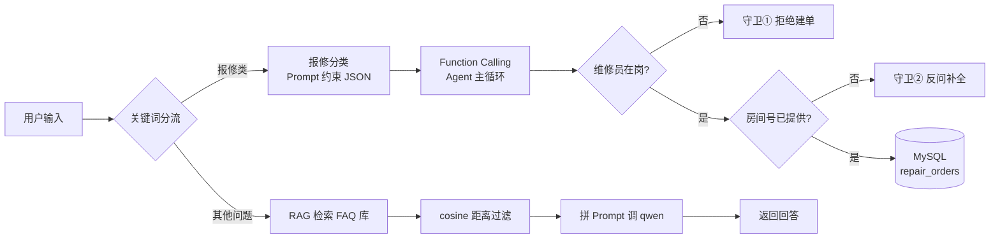

# AI 驱动宿舍维修系统

把「学生一句话报修」到「工单落进数据库」的整条链路交给大模型，同时用代码守住业务底线。

> 这是一个 AI 能力模块，不是一个完整的维修管理系统 —— 业务外壳（登录、工单列表页等）不在范围内，重点是三个 AI 功能各自的实现方式，以及它们怎么合成一条链路。

## 三个 AI 功能

| 功能 | 做什么 | 关键技术 |
|------|--------|---------|
| **报修分类** | 一句话自动判断问题类别 + 紧急程度 | Prompt 约束模型输出 JSON |
| **智能问答** | 基于维修 FAQ 知识库回答问题，**查不到就明说不知道** | RAG：向量检索 → 阈值过滤 → 拼 Prompt |
| **自动建单** | 一句话自动创建工单并写入数据库 | Function Calling + Agent 主循环 |

三个功能由 `05_整合入口/ai_service.py` 的 `handle()` 统一入口按关键词分流：
- 含「修 / 坏 / 漏 / 堵 / 响 / 裂」→ 走报修流程（分类 → 建单）
- 其他 → 走 RAG 问答

## 整体流程



## 技术栈

| 组件 | 用途 |
|------|------|
| Python 3.10 | 运行环境 |
| 通义千问 qwen（DashScope） | 大模型：分类、生成回答、Function Calling |
| text-embedding-v3 | 文本向量化 |
| ChromaDB | 向量数据库，存 FAQ 并做相似度检索 |
| MySQL | 业务数据库，存工单 |
| Flask | 网页问答接口 |
| dashscope / openai SDK | 两套 SDK 并存：`01_公共模块/qwen_client.py` 用 dashscope 原生 SDK，整合入口用 openai 兼容模式 |

> **关于两套 SDK**：`qwen_client.py` 用 `dashscope.Generation`，而 `agent_repair.py` / `ai_service.py` 改用 `openai.OpenAI` 的兼容模式端点。这是演进过程留下的，不是设计缺陷 —— 兼容模式在写 Function Calling 时更顺手。
>
> **关于目录编号**：`01_` ~ `06_` 只是**阅读顺序**，不代表依赖层级。目录按功能划分，跨目录的 `import` 已在各入口文件顶部用 `sys.path` 处理，因此**在任意目录下运行都能找到模块**。

## 目录结构

```
ai-repair/
├── 01_公共模块/                  # 被其他模块复用的基础设施
│   ├── qwen_client.py            # dashscope 调用封装（重试 / 指数退避 / 备用模型）
│   └── prompt_templates.py       # Prompt 模板库
├── 02_报修分类/                  # 功能①：报修文本 → 类别 + 紧急度
│   ├── classifier.py             # classify_repair(text) → {category, urgent}
│   └── qwen-test.py              # 演示：封装前 vs 封装后写法对比
├── 03_知识库问答/                # 功能②：RAG 问答
│   ├── faq_kb.py                 # 建库：20 条 FAQ 向量化后存入 ChromaDB
│   ├── faq_kb_注释版.py           # 同上，逐行注释版（复习用）
│   ├── rag_qa.py                 # rag_answer()：检索 → 阈值过滤 → 拼 Prompt
│   ├── rag_qa_注释版.py           # 同上，逐行注释版（复习用）
│   ├── embedding_demo.py         # Embedding 语义相似度对照实验
│   └── 8.14调参记录.txt           # Top-K / 阈值调参结论
├── 04_自动建单/                  # 功能③：Function Calling + Agent
│   ├── tools.py                  # 工具 schema + 真实实现（写 MySQL）
│   ├── auto_order.py             # FC 单轮版示例
│   ├── agent_repair.py           # FC 主循环 + 守卫①（不在岗拒单）
│   └── agent_repair_注释版.py     # 主循环逐行注释版（复习用）
├── 05_整合入口/
│   └── ai_service.py             # handle()：关键词分流，两个守卫都在这里
├── 06_网页接口/
│   ├── chat_注释版.py             # Flask 接口 POST /api/chat
│   └── chat.html                 # 最简聊天框
├── chroma_db/                    # ChromaDB 持久化数据（可由 faq_kb.py 重新生成）
├── 学习回顾.md                    # 概念 ↔ 代码位置对照表
├── 项目技术总结.docx              # 三个 AI 功能的技术总结
└── 周记 / 周记2                   # 学习进度记录
```

## 快速开始

### 1. 环境要求

- Python 3.10+
- MySQL 5.7+ / 8.0（本地运行即可）

### 2. 安装依赖

```bash
pip install chromadb dashscope openai pymysql flask flask-cors
```

### 3. 配置 API Key

代码通过环境变量读取密钥，**不写死在代码里，也不设任何兜底值**（避免密钥进代码）。

两种读法的差异，按实际情况分别说明：

| 写法 | 缺失时的表现 |
|---|---|
| `os.environ["DASHSCOPE_API_KEY"]`（`ai_service.py`） | 立即抛 `KeyError`，启动即暴露 |
| `os.environ.get("DASHSCOPE_API_KEY")`（其余脚本） | 返回 `None`，不报错，直到调用 API 才失败 |

两条路的共同点：**都不会回退到代码里的内置密钥**。

```bash
# Windows（永久生效，之后需要重开终端）
setx DASHSCOPE_API_KEY "sk-你的key"
```

Key 从[阿里云百炼控制台](https://bailian.console.aliyun.com/)获取。

### 4. 初始化数据库

建库 `cjl_505`，再建三张表（**已有表可跳过**）。

`students` 和 `workers` 是必须的 —— 它们被 `repair_orders` 的外键引用，缺任何一张，AI 建单都会写入失败：

```sql
CREATE DATABASE IF NOT EXISTS cjl_505 DEFAULT CHARSET utf8mb4;
USE cjl_505;

-- 学生表：建单时带上报修人身份
CREATE TABLE students (
  id            INT AUTO_INCREMENT PRIMARY KEY,
  name          VARCHAR(50)  NOT NULL,
  student_no    VARCHAR(20)  NOT NULL,
  email         VARCHAR(100) NOT NULL,
  password_hash VARCHAR(256) NOT NULL,
  phone         VARCHAR(20),
  created_at    DATETIME     NOT NULL
) ENGINE=InnoDB DEFAULT CHARSET=utf8mb4;

-- 维修工表：守卫①查的就是这张表的 worker_no
CREATE TABLE workers (
  id            INT AUTO_INCREMENT PRIMARY KEY,
  name          VARCHAR(50)  NOT NULL,
  email         VARCHAR(100) NOT NULL,
  password_hash VARCHAR(256) NOT NULL,
  worker_no     VARCHAR(20)  NOT NULL,
  phone         VARCHAR(20),
  created_at    DATETIME     NOT NULL
) ENGINE=InnoDB DEFAULT CHARSET=utf8mb4;

-- 工单表：字段按真实表结构给出，status 流转 pending_review→approved→accepted→finished
CREATE TABLE repair_orders (
  id            INT AUTO_INCREMENT PRIMARY KEY,
  student_id    INT          NOT NULL,
  student_no    VARCHAR(20)  NOT NULL,
  worker_id     INT,
  dorm_building VARCHAR(50)  NOT NULL,
  room_no       VARCHAR(20)  NOT NULL,
  category      VARCHAR(50)  NOT NULL,
  description   TEXT         NOT NULL,
  status        VARCHAR(30)  NOT NULL DEFAULT 'pending_review',
  audit_note    TEXT,
  result_note   TEXT,
  result_image  VARCHAR(255),
  created_at    DATETIME     NOT NULL,
  reviewed_at   DATETIME,
  accepted_at   DATETIME,
  finished_at   DATETIME,
  FOREIGN KEY (student_id) REFERENCES students(id),
  FOREIGN KEY (worker_id)  REFERENCES workers(id)
) ENGINE=InnoDB DEFAULT CHARSET=utf8mb4;
```

**初始数据（必须插）**：`tools.py` 的 `create_work_order` 固定写 `student_id = 1`，所以 id=1 的学生必须存在，否则外键约束会让建单失败。

```sql
INSERT INTO students (id, name, student_no, email, password_hash, created_at)
VALUES (1, '测试学生', 'js23150301', 'test@example.com', 'placeholder', NOW());

INSERT INTO workers (id, name, email, password_hash, worker_no, created_at) VALUES
  (1, '张维修', 'w1@example.com', 'placeholder', 'WX001', NOW()),
  (2, '刘浩',   'w2@example.com', 'placeholder', 'WX002', NOW()),
  (3, '王以',   'w3@example.com', 'placeholder', 'WX003', NOW());
```

> `password_hash` 填占位字符串即可，本项目不涉及登录功能。若同时运行宿舍维修 Web 系统，它用的是**同一个库、同一张 `repair_orders`**（完整建表脚本还含 `admins` / `email_codes` 两张表），密码哈希由它启动时生成。

连接参数在 `04_自动建单/tools.py` 的 `get_conn()` 里，按自己环境改（默认 `localhost:3306` / `root` / 库名 `cjl_505`）。

### 5. 初始化 FAQ 知识库

只需跑一次，把 20 条维修 FAQ 向量化后存进 ChromaDB：

```bash
python 03_知识库问答/faq_kb.py
```

### 6. 运行与验证

**三个功能分别单独验证：**

```bash
python 02_报修分类/classifier.py        # ① 分类：5 条报修测试文本
python 03_知识库问答/rag_qa.py          # ② 问答：空调不制冷 / 洗衣机坏了
```

```bash
python 04_自动建单/auto_order.py        # ③ FC 单轮版：模型决定调工具 → 执行 → 汇总回答
python 04_自动建单/agent_repair.py      # ③ FC 主循环版 + 守卫①
```

**整合入口（推荐）：**

```bash
python 05_整合入口/ai_service.py        # 三合一：报修建单 + RAG 问答一次跑通
```

**网页问答：**

```bash
python 06_网页接口/chat_注释版.py        # 起 Flask 服务，浏览器打开 chat.html 即可提问
```

> 以上命令都在**项目根目录**下执行即可。各入口文件顶部已用 `sys.path` 自动挂好依赖目录，不必 `cd` 进子目录，跨目录导入不会再报 `ModuleNotFoundError`。

## 效果示例

`python 05_整合入口/ai_service.py` 的典型输出 —— 四种情况一次走完（模型措辞会有出入，逻辑一致）：

```
用户:505水管爆了，尽快安排维修
系统分类: {'category': '水管', 'urgent': '是'}
系统：已为您创建工单（工单号 18），问题：505 房间水管爆裂，优先级 high，当前状态 pending_review，请等待审核。

用户:505水管爆了，派工人WX999来修
系统分类: {'category': '水管', 'urgent': '是'}
系统：工号 WX999 不存在，无法派单，请确认正确的维修工工号。

用户:空调不制冷怎么办
系统：请先检查遥控器是否调到制冷模式、温度是否低于室温；若正常请报修，空调加氟或清洗滤网由维修师傅处理。

用户:宿舍晚上几点关门
系统：抱歉，资料里没有相关信息，我无法回答。
```

四段分别对应：**分流到报修 + 正常建单** / **守卫①拒绝无效工号** / **RAG 命中知识库** / **RAG 反幻觉兜底**。

最后一条是 RAG 的**反幻觉设计**：知识库里没有的内容，系统会承认不知道，而不是编一个答案。

## 几个关键设计决策

**1. 为什么用 cosine 距离而不是默认的 L2？**

ChromaDB 默认是欧氏距离，但文本相似度用余弦更合理 —— 向量长度受文本长短影响，余弦只看方向。建库和查询两侧都显式设了 `metadata={"hnsw:space": "cosine"}`，口径必须一致，否则检索结果会毫无意义。

> 注意：cosine 空间下 ChromaDB 返回的 `distances` 是**距离**（= 1 − 相似度），**越小越相似**。所以 `rag_qa.py` 里 `if s <= 0.5` 的含义是「距离不超过 0.5 才保留」，等价于「相似度 ≥ 0.5」。

**2. 为什么 Top-K = 3、阈值 = 0.5？**

这是 8/14 的对照实验结论（记录在 `8.14调参记录.txt`）：K=1 信息太窄，K=8 会混入无关资料；阈值 0.5 能挡住「洗衣机」这类知识库里没有的问题。阈值过滤是**防幻觉的第一道防线**，Prompt 里「资料里没有的就直接说不知道」是第二道。

**3. 为什么业务规则要写死在代码里，不能交给 Prompt？**

模型的输出是概率性的，Prompt 只能提高它遵守规则的概率，做不到 100%。所以「维修员在岗才派单」「房间号缺失不建单」这类**绝不能出错**的规则，必须在工具执行前用代码拦截（`05_整合入口/ai_service.py`）：

```python
if not worker_available:
    result = {"error": "维修员不在岗,按规则拒绝建单,请更换维修员"}
elif not str(func_args.get("room", "")).strip() or func_args.get("room") in ("未知", "unknown", "无", "null"):
    result = {"error": "房间号缺失,请先询问用户房间号后再建单"}
else:
    result = create_work_order(**func_args)
```

其中 `worker_available` 不是凭空来的，它由 `check_workers_available()` **真查数据库**得出，规则两条：

1. 工号必须存在于 `workers` 表（查 `worker_no`）
2. 该维修工手上不能有 `approved` / `accepted` 状态的未完工工单

之所以拦得住，是因为**模型没有执行能力** —— 它只能「请求」调用工具，真正的执行权在代码手里。这是 Function Calling 架构比纯 Prompt 可靠的根本原因。

**4. 为什么分类结果要以 system prompt 注入？**

先由 `classifier.py` 分类，再把结果写进 system prompt，并要求模型「category 和 priority 必须使用上述值，不要自己编」。这样模型只负责填工具参数，不负责决定类别 —— 把不确定性收敛到可控范围内。

## 进度

- [x] 报修分类（8/10）
- [x] Embedding 语义相似度实验（8/11）
- [x] FAQ 知识库 + ChromaDB（8/12）
- [x] RAG 问答（8/13）
- [x] Top-K / 阈值调参（8/14）
- [x] 网页问答接口（8/15）
- [x] Function Calling 工具定义 + MySQL 落库（8/19）
- [x] FC 主循环 + 业务守卫（8/22）
- [x] 三模块整合入口 `ai_service.py`（8/23）
- [x] README / 项目文档整理

## 已知局限

- **没有会话记忆**：每轮请求独立，模型不记得上一句话。多轮追问要靠用户重新说清上下文。
- **没有上下文截断**：一旦加上记忆，长对话会超出 context window，需要截断策略。
- **分类靠关键词分流**：`handle()` 用「修/坏/漏/堵/响/裂」判断是否走报修流程，遇到不含这些字的报修（如「空调不工作」）会误判成问答。更稳的做法是意图分类。
- **守卫①依赖模型主动查岗**：`worker_available` 默认 `True`，只有模型先调用 `check_workers_available` 并拿到「不可用」，它才会变成 `False`。**若模型跳过查岗直接建单，守卫①就不生效。** 更可靠的做法是不依赖模型记得调用，而是由代码在建单前无条件校验（把校验挪进工具执行路径）。这一点在设计上尚未做到 —— 相比之下守卫②是无条件生效的。
- **建单身份是写死的**：`create_work_order` 固定 `student_id = 1` / `student_no = js23150301` / `dorm_building = 1号楼`，所以 AI 建的单都挂在「测试学生」名下。要真正多用户，这几个值应从会话中取，作为工具参数传入。
- **未部署**：目前只能在本地跑，没有 Docker 化。
